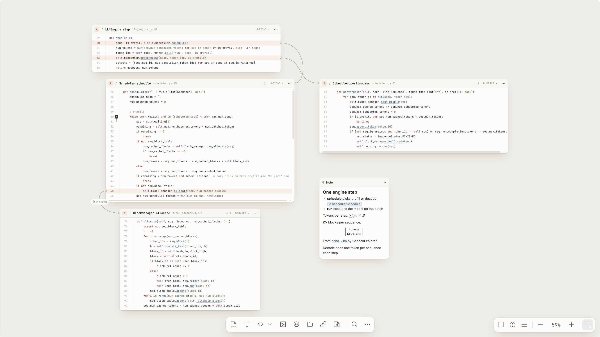
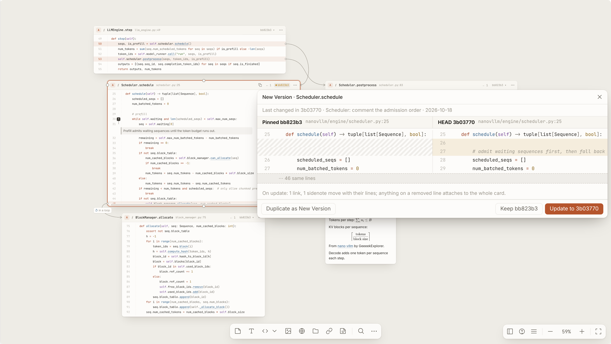
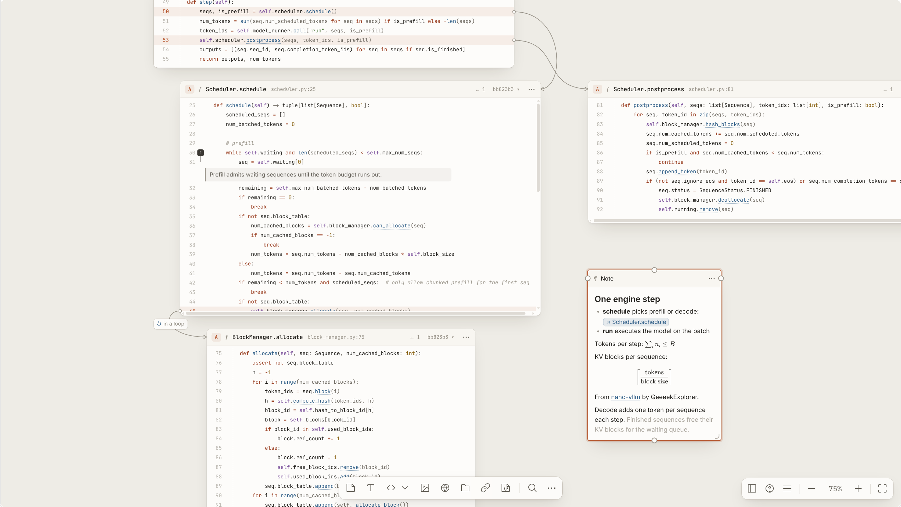
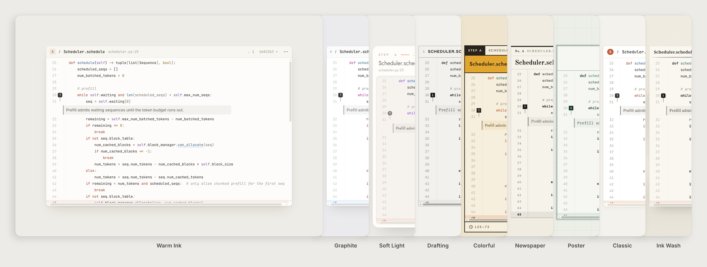
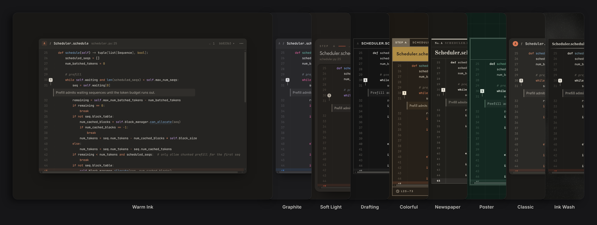

<p align="center">
  
</p>

<h1 align="center">CodeBoard</h1>

<p align="center">
  <em>Reading code can be elegant and joyful.</em>
</p>

<p align="center">
  A whiteboard for reading code. Lay out how a codebase really flows,<br>
  with every card pinned to its source and its commit.
</p>

<p align="center">
  <a href="https://github.com/yhnocoder/codeboard/releases/latest">Download</a> ·
  <a href="#getting-started">Getting started</a> ·
  <a href="#features">Features</a> ·
  <a href="CONTRIBUTING.md">Contributing</a>
</p>

<p align="center">
  <a href="LICENSE"></a>
  
  
</p>



## Why CodeBoard

Understanding a large codebase means holding a lot in your head at once: which function calls which, where the data goes, what you already figured out. Editors show one file at a time, and diagrams drawn by hand drift away from the code the moment it changes.

CodeBoard gives that understanding a place to live. Put a function on the board, click its calls to expand them layer by layer, and arrange the result the way you think about it. Every card stays connected to the exact lines and commit it came from, so the board remains a faithful map of the code rather than a sketch of it.

It was built for studying LLM inference and training codebases such as [nano-vllm](https://github.com/GeeeekExplorer/nano-vllm), [SGLang](https://github.com/sgl-project/sglang) and [DeepEP](https://github.com/deepseek-ai/DeepEP), and works with any language your editor understands.

## Features

**Expand calls, layer by layer.** Calls inside a card are underlined. Click one and its definition is placed on the board, connected by an arrow from the calling line. CodeBoard asks the language server (Pylance, clangd, …) for definitions and falls back to a workspace search by name and receiver, so string-dispatched calls such as `model_runner.call("run")` expand too.

**Cards pinned to commits.** Each card remembers the commit it was taken from. When code only moves, the card follows quietly. When a function actually changes, the card offers a **New version** with its diff, and you decide whether to update or keep the pinned code. Highlights and arrows move with the content.



**Notes that format as you type.** Markdown Notes with headings, lists, code blocks, inline and display math, and `[[card references]]` that link to cards on the board. Optional inline completions (DeepSeek, or a VS Code language model such as GitHub Copilot) suggest how to finish a sentence. Sidenotes attach comments to specific lines of a card.



**Code and board, side by side.** The board opens beside your editor. Click any line of a card to jump to it in the source; a CodeLens in the editor takes you back to the card. Hover a call to peek at its definition without adding it to the board.

**And more.**

- Present a board card by card with `P`, then `←` `→` to move and `Esc` to leave.
- Draw, label and retype arrows; drop in images and web pages; highlight lines.
- Find and replace while editing a Note or a code card: `⌘F` (`Ctrl+F`), `⌥⌘F` (`Ctrl+Alt+F`) for replace.
- Compare a card across branches, worktrees or pull requests, with change marks and a three-way view.
- Turn a group of cards into a sub-board, or share one card across several boards.
- Copy or move a board to another project, with its sub-boards, shared cards and images.
- Browse a GitHub repository from the sidebar, or paste a GitHub file link onto a board.
- Pin questions to code with `?` stickers and collect them in the Questions view.
- Export a board as Markdown, a standalone HTML snapshot, or a PNG.
- Nine board themes, each with a light and a dark variant that follows VS Code.





## Getting started

### Install

CodeBoard runs as a VS Code extension (VS Code 1.90 or later).

Install it from the [Visual Studio Marketplace](https://marketplace.visualstudio.com/items?itemName=yhnocoder.codeboard-vscode), or search for **CodeBoard** in the Extensions view. VSCodium, Cursor and other editors that use [Open VSX](https://open-vsx.org/extension/yhnocoder/codeboard-vscode) can install it from there.

To install a specific version by hand, download its `.vsix` from [Releases](https://github.com/yhnocoder/codeboard/releases) and run **Extensions: Install from VSIX…** in VS Code.

### Your first board

1. Open a repository and place the cursor inside a function.
2. Press `Alt+B` (`⌥B` on macOS), or right-click and choose **Add to Board**. The board opens beside the editor with the function as a card.
3. Click the underlined calls to expand them. `Shift+1` fits the whole board, `Shift+2` fits the selection, and `?` lists every shortcut.

Selecting lines across several definitions and pressing `Alt+B` makes one card with several sections; `Shift+Alt+B` makes one card per definition.

For the best results with Python, install [Pylance](https://marketplace.visualstudio.com/items?itemName=ms-python.vscode-pylance); for C and C++, [clangd](https://marketplace.visualstudio.com/items?itemName=llvm-vs-code-extensions.vscode-clangd).

## Configuration

| Setting | Default | Description |
| --- | --- | --- |
| `codeboard.theme` | `warm-ink` | Board theme. Each has a light and a dark variant. |
| `codeboard.storageDir` | *(empty)* | Folder for board files. Empty uses VS Code's workspace storage, outside the repository. |
| `codeboard.ai.provider` | `auto` | Inline completions in Notes: `auto`, `copilot`, `deepseek` or `off`. |
| `codeboard.ai.deepseekModel` | `deepseek-flash` | DeepSeek model used for completions. |
| `codeboard.studyScope` | `[]` | Packages outside the workspace that count as project code, for example `torch`. |
| `codeboard.zoom.overview` | `0.6` | Below this zoom level, cards show an overview instead of code. |
| `codeboard.doubleClick` | `text` | What double-clicking empty board space creates. |

Set a DeepSeek API key with **CodeBoard: Set DeepSeek API Key**. It is kept in VS Code's secret storage.

## Privacy

CodeBoard runs locally and collects no telemetry. Boards are stored on your machine, in VS Code's workspace storage or in `codeboard.storageDir`, and nothing is written into the repository you are reading. Only these features reach the network:

- **Gray inline completions** (in Notes and Free code cards): the text around the caret (up to a few thousand characters) goes to a VS Code language model such as GitHub Copilot or, only if you set a DeepSeek API key, to DeepSeek. Turn them off with `"codeboard.ai.provider": "off"`.
- **GitHub**: the GitHub Files sidebar, pasted GitHub file links and pull-request variants read from GitHub's API, signed in with your VS Code GitHub account when a repository needs it.
- **Web page cards**: pasting a link fetches that page once for its title, description and images, which are saved with the board. Images that a Note links by URL load from that URL.

## Roadmap

CodeBoard is in early preview, and file formats may still change between releases (older boards are upgraded automatically). Planned next:

- A standalone desktop app for macOS. The board UI does not depend on VS Code, so it can move to other hosts.
- Runtime tracing: showing the actual inputs and outputs of Python functions on their cards.

Ideas and bug reports are welcome in [Issues](https://github.com/yhnocoder/codeboard/issues).

## Contributing

The repository is an npm workspace:

| Path | Contents |
| --- | --- |
| [`packages/analysis`](packages/analysis) | Code analysis with tree-sitter: symbols, calls and cross-language boundaries in Python, C / C++ / CUDA and Rust. |
| [`packages/core`](packages/core) | Data model and keeping cards in sync with the code. Pure TypeScript. |
| [`packages/board`](packages/board) | The board UI, built with SolidJS. Independent of any editor. |
| [`packages/host`](packages/host) | Reads code, highlights, resolves calls, tracks versions, and stores boards. Independent of any editor. |
| [`packages/markdown`](packages/markdown) | The Markdown editor and renderer used by Notes, published on npm as [`@yhnocoder/markdown`](https://www.npmjs.com/package/@yhnocoder/markdown). |
| [`extensions/vscode`](extensions/vscode) | The VS Code extension: connects the host and the board to VS Code. |
| [`examples`](examples) | Real codebases (git submodules) used for testing and demos. |

```bash
git clone --recurse-submodules https://github.com/yhnocoder/codeboard.git
cd codeboard
npm install
npm run build    # board UI and extension
npm run package  # build, then pack an installable .vsix into extensions/vscode/
npm test         # unit tests
```

See [CONTRIBUTING.md](CONTRIBUTING.md) for the development workflow and architecture rules, and [TESTING.md](TESTING.md) for how tests are organized.

## License

[MIT](LICENSE) © 2026 CodeBoard Team
