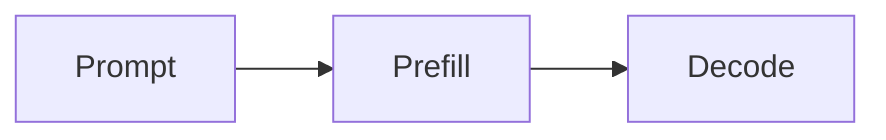

# Paged KV cache

[toc]

A short note that uses everything `@yhnocoder/markdown` supports :rocket:. Click anywhere in it to edit; press <kbd>Esc</kbd> to save.

## Text

**Bold**, *italic*, ~~struck~~, `code`, <u>underlined</u>, ==highlighted==, H~2~O and x^2^. A [link](https://example.com) and two
wiki links: [[Paging]] resolves through the page's own callback, [[Nowhere]] does not.

> Blocks are allocated by reference count.[^1]

## Lists

- prefill takes the whole prompt
- decode takes one token
  1. look up the block table
  2. append the new slot

- [x] hash full blocks
- [ ] evict the least recently used

## Table

| Phase | Tokens per step |
| --- | --- |
| prefill | whole prompt |
| decode | 1 |

## Code

```python
def allocate(self, seq):
    # first free block
    block = self.free[0]
    return len(seq) * 2
```

## Math

Cost is $O(n^2)$ per step, and in total

$$
\sum_{i=1}^{n} x_i = \frac{a}{b}
$$

## Diagram



## Image


<details>
<summary>Why not one big buffer?</summary>

Fragmentation: sequences grow at different speeds.

</details>

[^1]: Shared prefixes keep one copy.
