**Screenshot diff**: 30 steps, 19 changed.

**r01-first-card** · changed · 1.8% of pixels

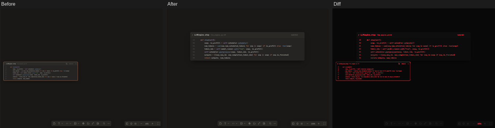

**r08-new-cards** · changed · 0.9% of pixels

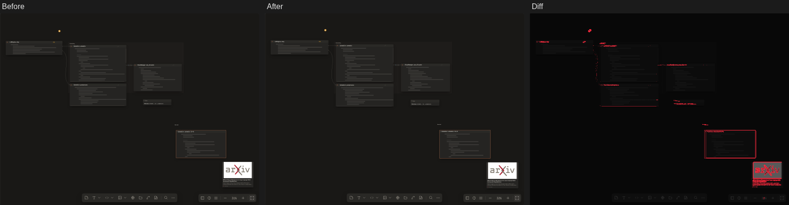

**r09-menu-edges** · changed · 1.4% of pixels

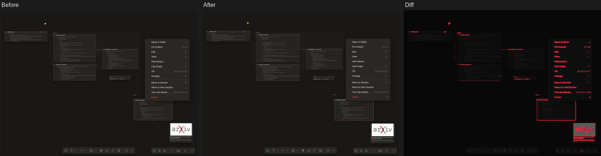

**r11b-zoom-fit** · changed · 0.8% of pixels

**r12-undo-redo** · changed · 0.6% of pixels

**r13-reopen** · changed · 0.7% of pixels

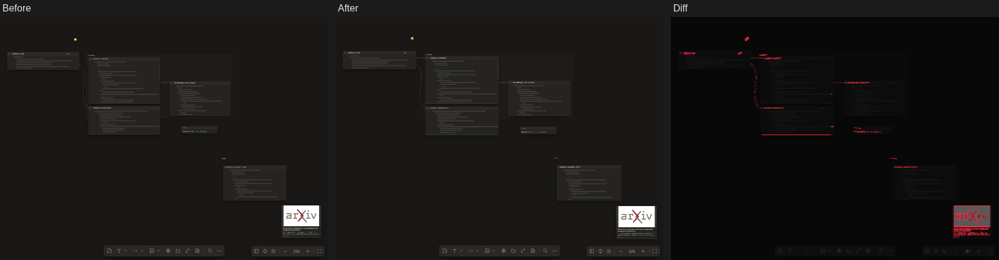

**r14-theme-01-warm-ink** · changed · 0.7% of pixels

**r14-theme-02-graphite** · changed · 0.7% of pixels

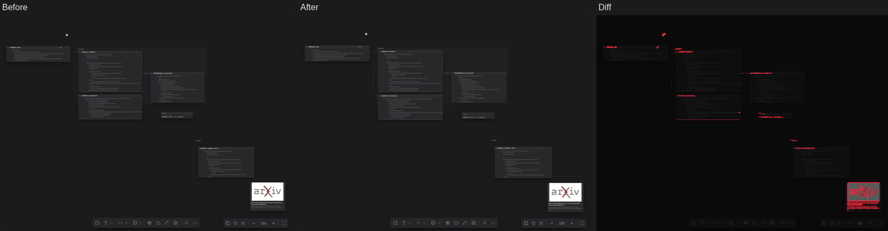

**r14-theme-03-soft-light** · changed · 0.6% of pixels

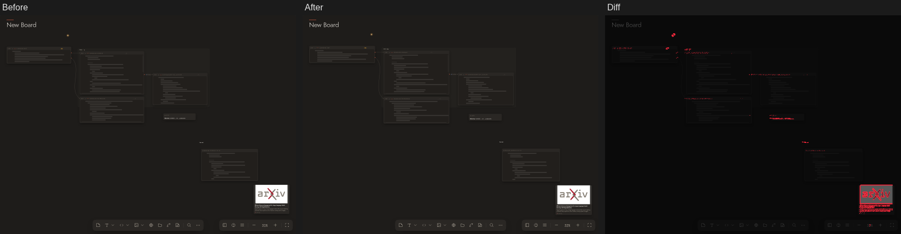

**r14-theme-04-drafting** · changed · 0.8% of pixels

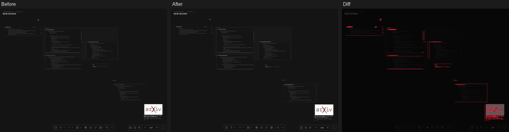

**r14-theme-05-colorful** · changed · 2.4% of pixels

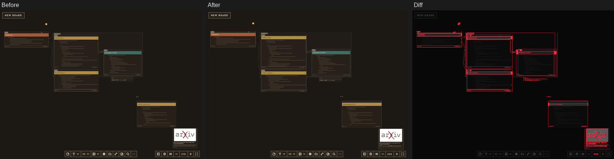

**r14-theme-06-newspaper** · changed · 1.2% of pixels

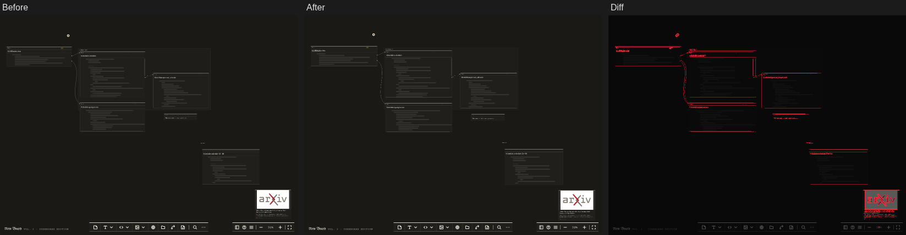

**r14-theme-07-poster** · changed · 2.1% of pixels

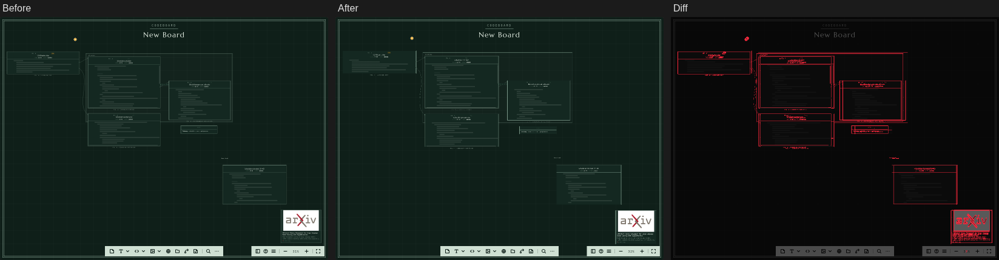

**r14-theme-08-classic** · changed · 0.7% of pixels

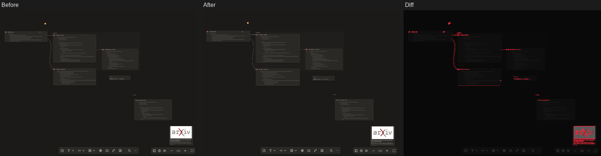

**r14-theme-09-ink-wash** · changed · 0.7% of pixels

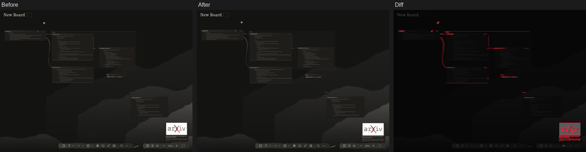

**r14-theme-10-city** · changed · 1.7% of pixels

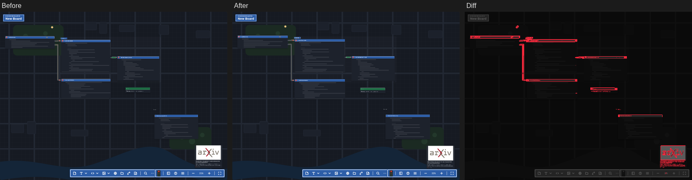

**r14-themes** · changed · 0.7% of pixels

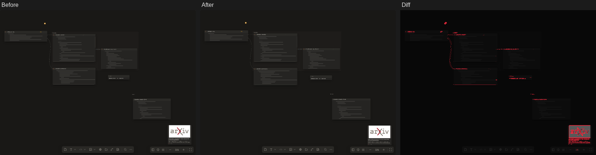

**r15-paste-near** · changed · 0.7% of pixels

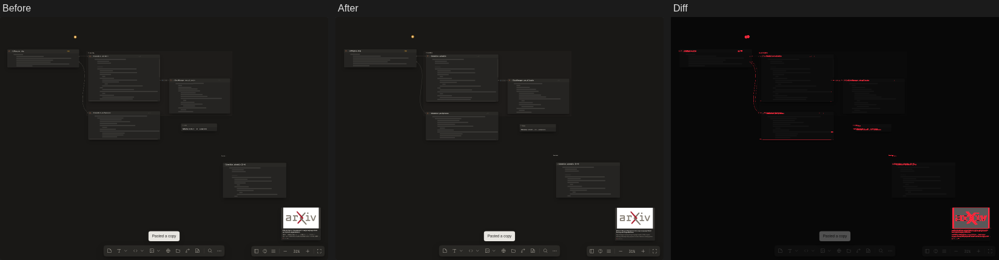

**r18-drag-body** · changed · 0.5% of pixels

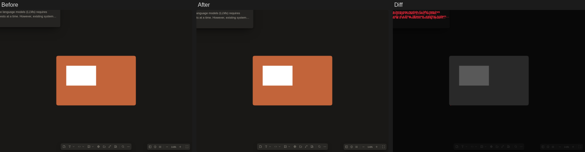
