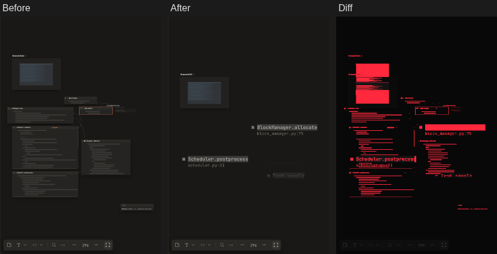
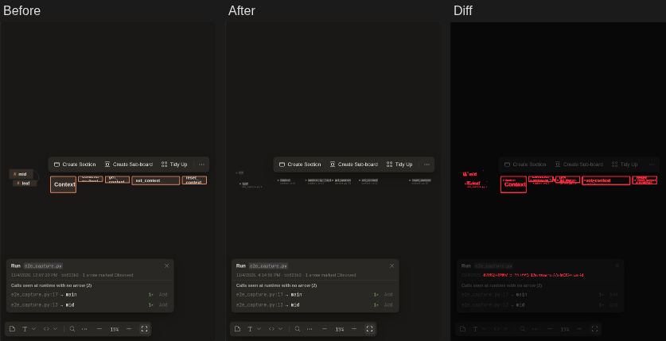
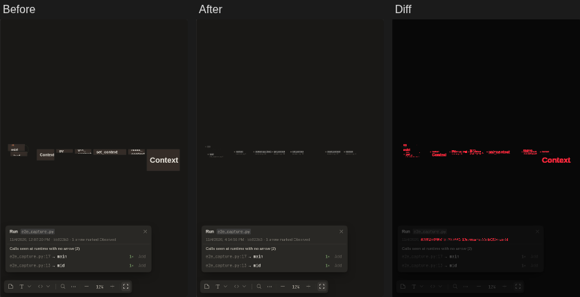
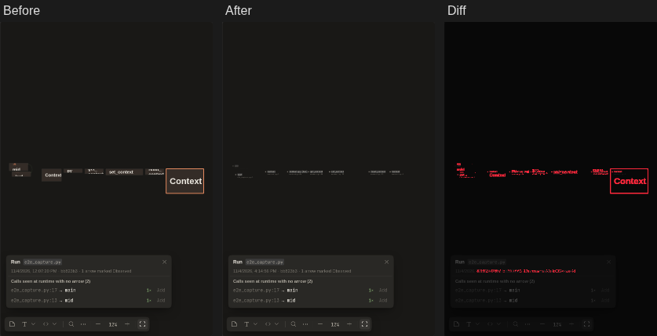
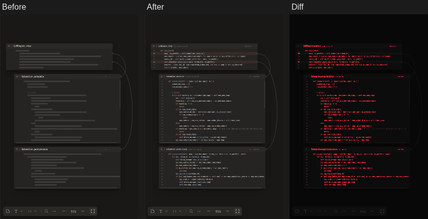
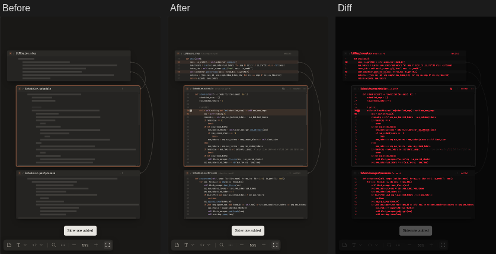
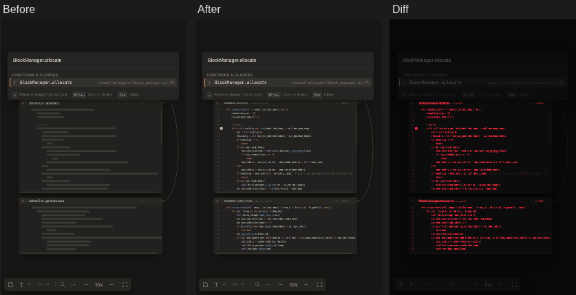
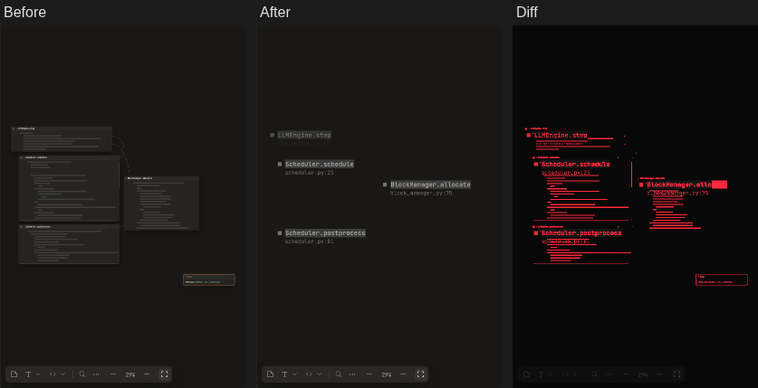
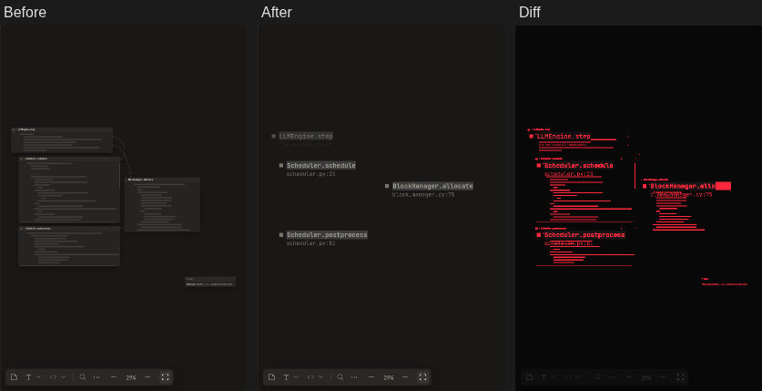
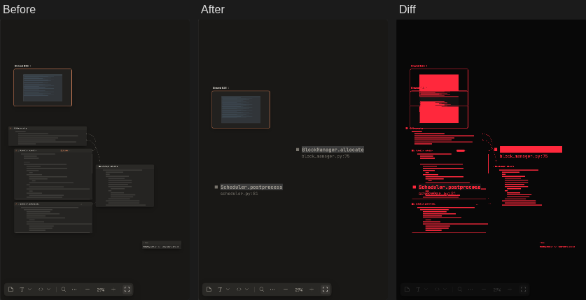

**Screenshot diff**: 21 steps, 12 changed.

**10-pick-impl** · changed · 7.0% of pixels

**16-addsel-one-card** · changed · 0.8% of pixels

**17-addsel-separate** · changed · 1.2% of pixels

**18-cardfocus-code** · changed · 0.7% of pixels

**18-cardfocus-header** · changed · 0.8% of pixels

**2-flow** · changed · 3.1% of pixels

**4-sidenote** · changed · 3.1% of pixels

**5-search** · changed · 2.3% of pixels

**6-board** · changed · 3.1% of pixels

**7-uncommitted** · changed · 3.0% of pixels

**7b-diagnostics** · changed · 3.0% of pixels

**9-subboard** · changed · 7.0% of pixels

