**Screenshot diff**: 21 steps, 15 changed.

**10-pick-impl** · changed · 8.6% of pixels

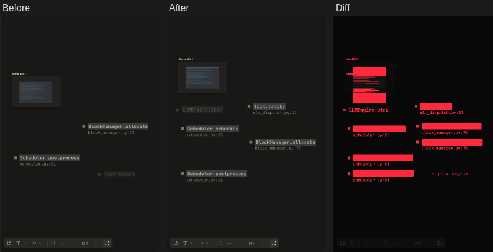

**11-capture-run** · changed · 0.5% of pixels

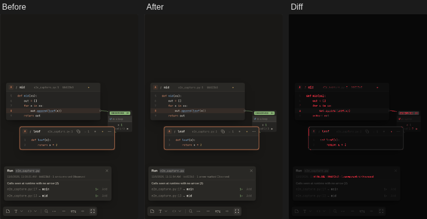

**16-addsel-one-card** · changed · 0.5% of pixels

**17-addsel-separate** · changed · 0.6% of pixels

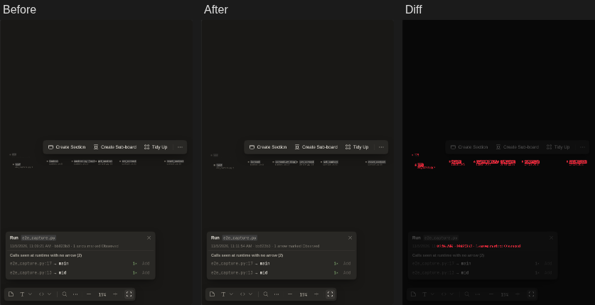

**18-cardfocus-code** · changed · 0.5% of pixels

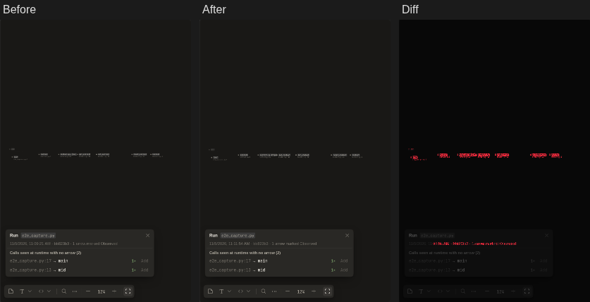

**18-cardfocus-header** · changed · 0.5% of pixels

**2-flow** · changed · 2.3% of pixels

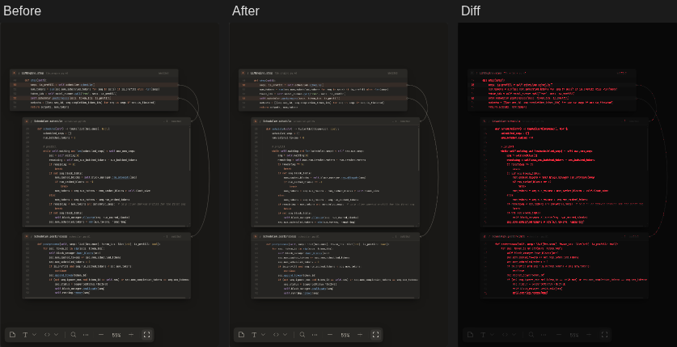

**3-peek** · changed · 1.3% of pixels

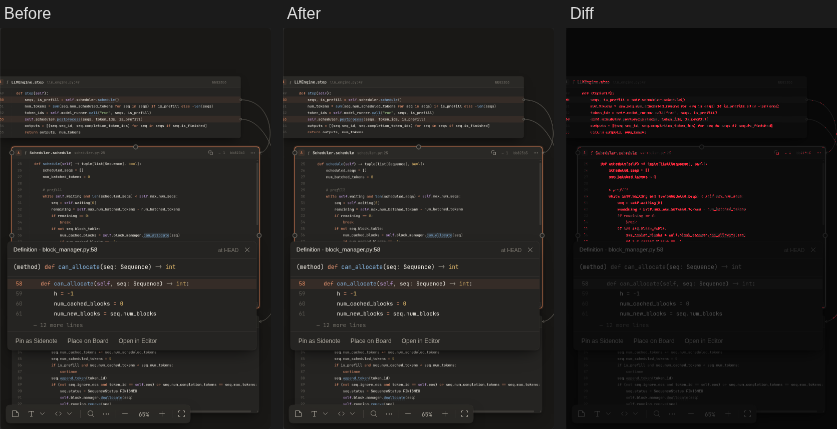

**4-sidenote** · changed · 2.6% of pixels

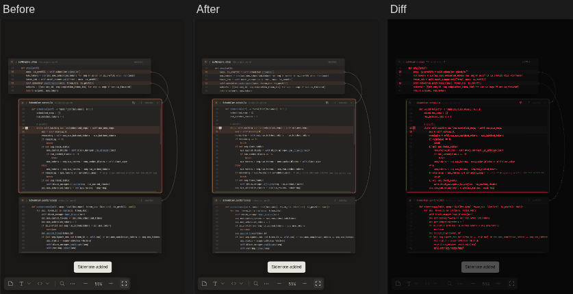

**5-search** · changed · 1.3% of pixels

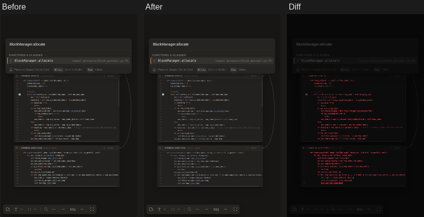

**6-board** · changed · 2.2% of pixels

**7-uncommitted** · changed · 2.2% of pixels

**7b-diagnostics** · changed · 2.2% of pixels

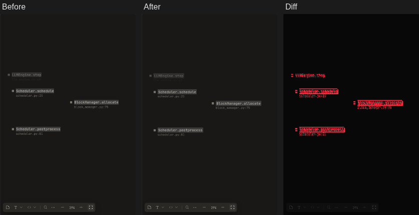

**8-shared** · changed · 1.0% of pixels

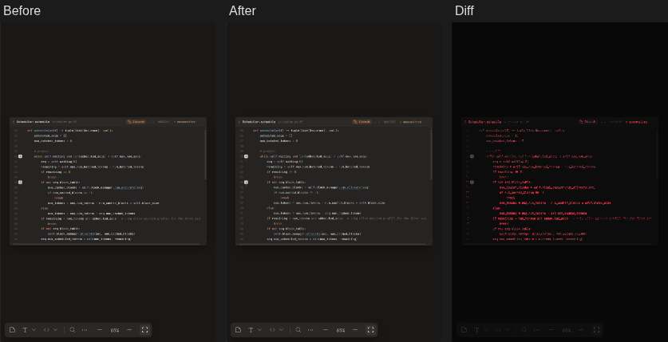

**9-subboard** · changed · 6.8% of pixels

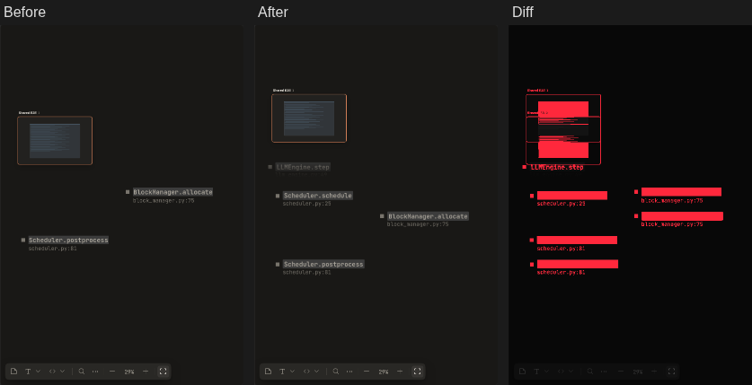
