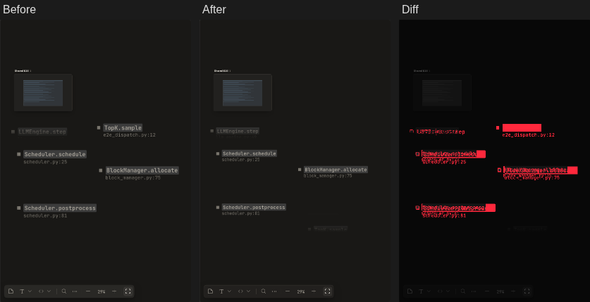
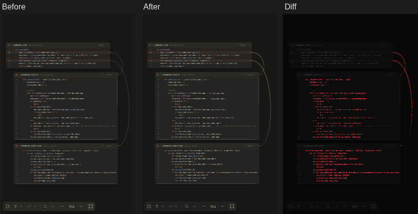
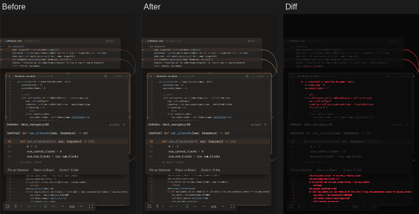
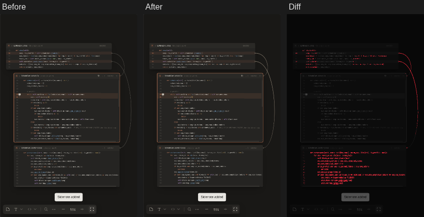
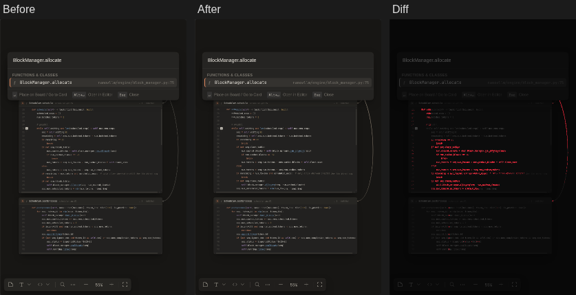
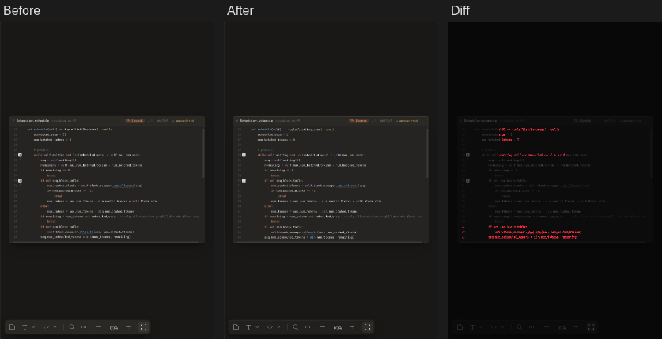
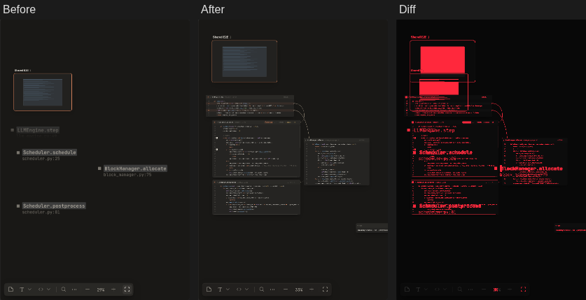

**Screenshot diff**: 21 steps, 7 changed.

**10-pick-impl** · changed · 2.9% of pixels

**2-flow** · changed · 1.5% of pixels

**3-peek** · changed · 1.5% of pixels

**4-sidenote** · changed · 1.3% of pixels

**5-search** · changed · 0.8% of pixels

**8-shared** · changed · 0.5% of pixels

**9-subboard** · changed · 6.5% of pixels

