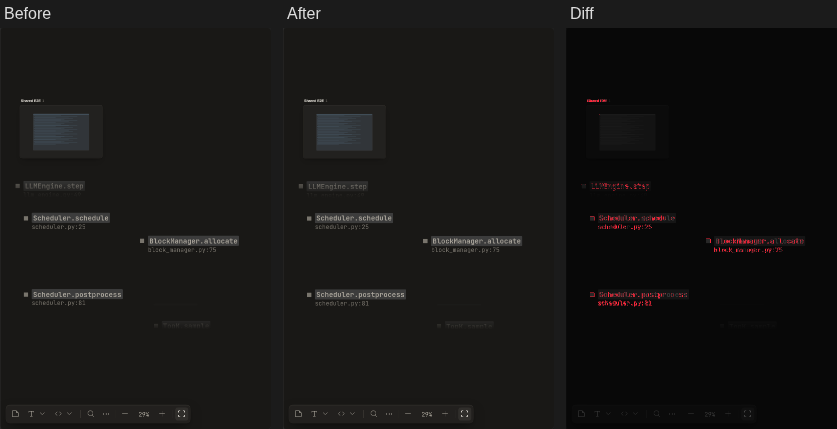
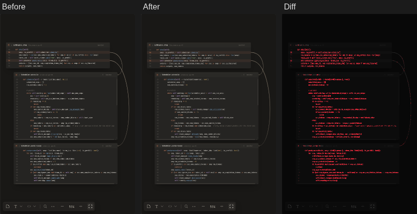
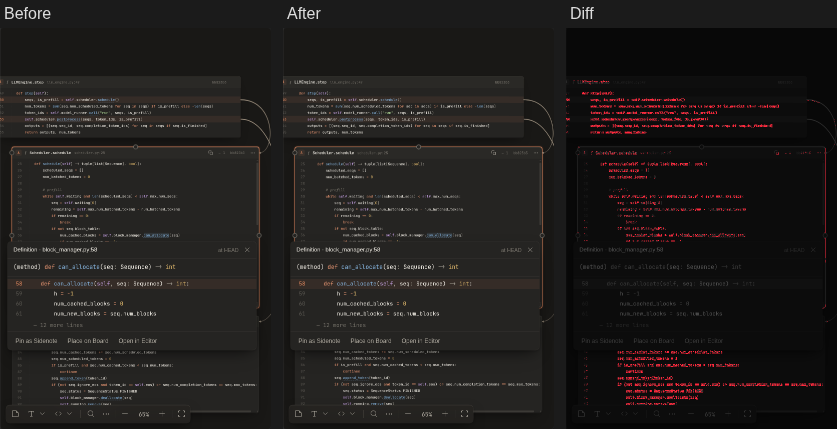
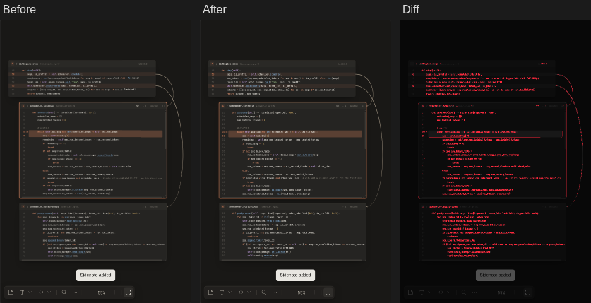
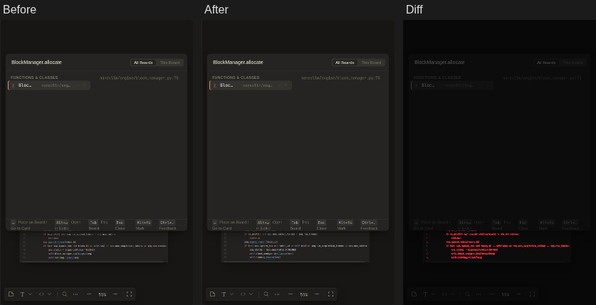
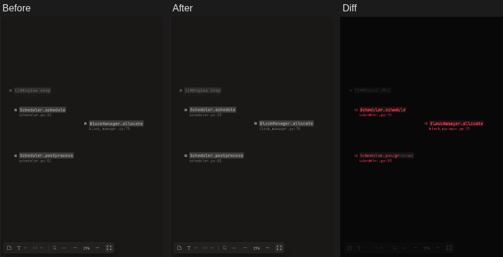
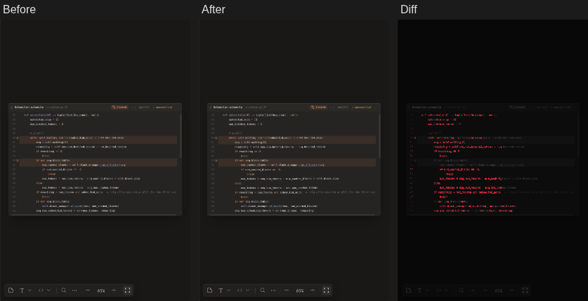
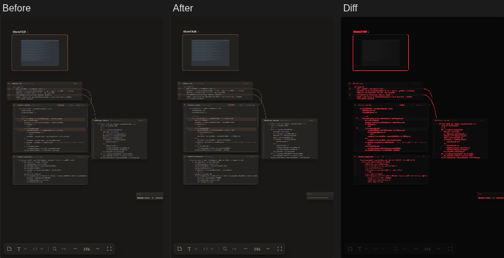

**Screenshot diff**: 21 steps, 10 changed.

**10-pick-impl** · changed · 0.5% of pixels

**2-flow** · changed · 3.2% of pixels

**3-peek** · changed · 2.4% of pixels

**4-sidenote** · changed · 3.5% of pixels

**5-search** · changed · 0.7% of pixels

**6-board** · changed · 0.6% of pixels

**7-uncommitted** · changed · 0.6% of pixels

**7b-diagnostics** · changed · 0.6% of pixels

**8-shared** · changed · 0.8% of pixels

**9-subboard** · changed · 2.4% of pixels

